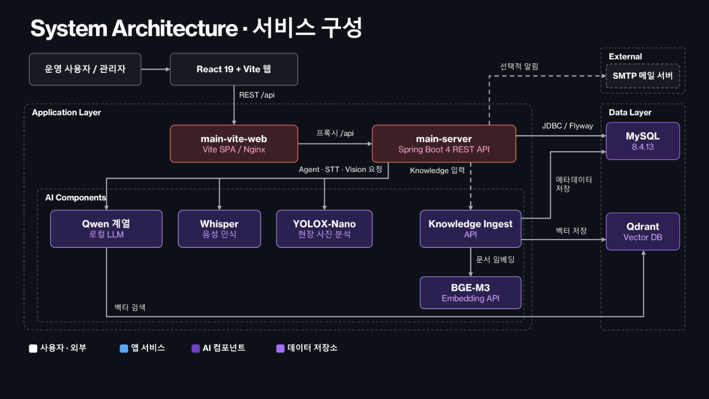
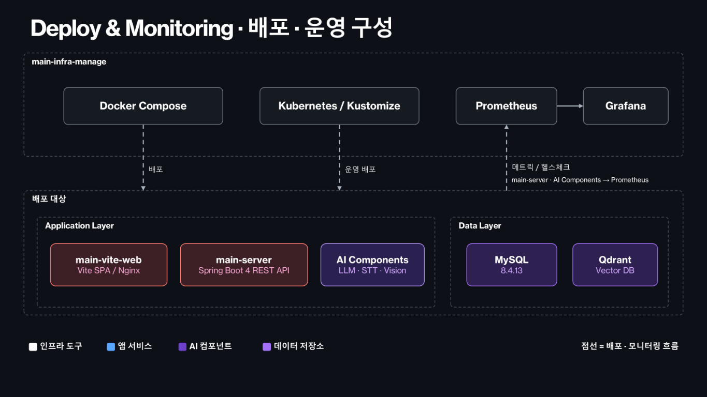
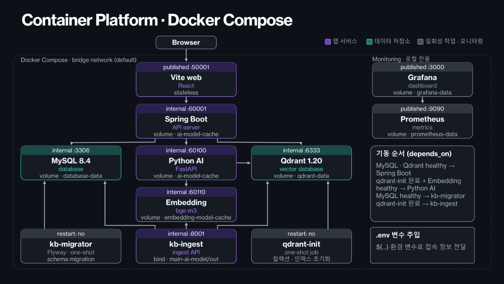

# Main Project

> [!NOTE]
> A version of the README in Korean can be found at [main-project-demo](./docs/localization/README.kr.md).

Top-level overview of the repositories that make up the **field safety
management service** — a platform that helps site operators and managers record,
review, and act on workplace safety events, augmented by AI for near-miss
detection, document search, image recognition, and voice input.

The service consists of a React web app, a Spring Boot API, Python AI services,
and an infrastructure repository that ties them together. Each repository is
developed and deployed independently, while local integration and Kubernetes
deployment are managed in the infrastructure repository.

## Key Features

- **Safety operations** — user and permission management, safety/work records,
  approval workflows, notifications, and audit reports (Spring Boot API).
- **AI assistance** — an AI agent, near-miss tagging, and safety-rule extraction
  backed by a local LLM (Qwen family).
- **Vision and speech** — on-site image analysis (YOLOX-Nano) and speech
  transcription (Whisper) for hands-free field reporting.
- **Knowledge search (RAG)** — document ingestion and embedding (BGE-M3) with
  vector search over Qdrant.
- **Integrated operations** — one-command local run via Docker Compose, a
  Kubernetes/Kustomize deployment, and Prometheus + Grafana monitoring.

## Architecture Overview



```text
[ vite-web ]  ──/api──▶  [ spring-server ]  ──▶  [ ai-model ]
  React web               Spring Boot API         FastAPI AI/RAG
                                │                       │
                                ▼                       ▼
                             MySQL                Qdrant · Embedding
                                └──────────┬──────────┘
                                   [ infra-manage ]
                          Docker Compose · Kubernetes · DB · Monitoring
```

- The web application forwards `/api` requests to the Spring Boot server.
- The Spring Boot server provides APIs for users/permissions, safety records,
  approvals, notifications, and audit reports, and calls the AI services when AI
  features are needed.
- The AI services provide agent, near-miss tagging, rule extraction, image
  recognition, and speech transcription features, along with RAG search
  (embedding + Qdrant).
- The infrastructure repository connects the four services via local Compose and
  Kubernetes, and manages database initialization/migration and monitoring
  configuration.

## Repositories

| Repository | Role | Tech stack |
|---|---|---|
| [vite-web](./vite-web) | React web app for field safety management | React 19, React Router 7, Vite 8, Node.js 24 |
| [spring-server](./spring-server) | Field safety management API server | Java 17, Spring Boot 4, MySQL, Flyway, JWT |
| [ai-model](./ai-model) | AI, embedding, and knowledge ingest services | Python 3.12, FastAPI, BGE-M3, Qdrant |
| [infra-manage](./infra-manage) | Integrated run and deployment infrastructure | Docker Compose, Kubernetes, MySQL, Grafana |

## Services and Ports

| Component | Local dev port | Docker port | Notes |
|---|---|---|---|
| Web (Vite) | 50001 | 50001 | Proxies `/api` requests to the server |
| API server (Spring Boot) | 8080 | 60001 | Swagger UI at `/swagger-ui/index.html` |
| AI API | 60100 | 60100 | Health check at `/health` |
| Embedding API | 60110 | 60110 | Readiness check at `/ready` |
| Knowledge ingest API | 8001 | 8001 | Readiness check at `/ready` |
| Qdrant init | — | one-off | Initializes collections and indexes |

## Quick Start

The simplest way to run everything together is with the infrastructure
repository's Docker Compose setup. All four repositories must live under the same
parent directory.

```text
main-project-demo/
├── vite-web/
├── spring-server/
├── ai-model/
└── infra-manage/
```

Create `infra-manage/docker/.env` with the required variables and secrets,
then run Compose from the infrastructure repository root.

```powershell
docker compose --env-file .\docker\.env -f .\docker\docker-compose.yml up -d --build
```

For the required environment variables, inter-container connection addresses, and
initialization tasks, see the
[Docker execution guide in infra-manage](./infra-manage/docker/README.md).

## Deployment and Operations

The `infra-manage` repository deploys the application and data layers via Docker
Compose and Kubernetes/Kustomize, and collects metrics and health checks from the
API server and AI components through Prometheus and Grafana.

### Deployment and monitoring overview



### Docker Compose topology



### Kubernetes topology


## Per-Repository Development

To develop and test each repository individually, refer to its README.

- Web: [vite-web/README.md](./vite-web/README.md) — `npm ci`, then `npm run dev`
- Server: [spring-server/README.md](./spring-server/README.md) — `\.\gradlew.bat bootRun`
- AI: [ai-model/README.md](./ai-model/README.md) — create `.venv`, then run `uvicorn`
- Infra: [infra-manage/README.md](./infra-manage/README.md) — Compose and Kubernetes

## Repository-wide configuration

- [`.gitignore`](./.gitignore) is managed only at the workspace root. Project-specific
  exclusions are scoped to their project directory.
- Docker Compose build contexts resolve `vite-web`, `spring-server`, and `ai-model`
  as sibling directories under `main-project-demo`.

## Collaborators

| Name | Role | GitHub |
|---|---|---|
| GEONWOO CHOI | Maintainer | [@geonwoo8873](https://github.com/geonwoo8873) |
| Mingi Choi | Contributor | [@GreyColor10](https://github.com/GreyColor10) |
| tmdwls1226 | Contributor | [@tmdwls1226](https://github.com/tmdwls1226) |
| 김영민 (Youngmin Kim) | Contributor | [@kymin9118](https://github.com/kymin9118) |

## Notes

- Manage passwords, JWT keys, internal API tokens, and mail/external service
  credentials via local environment variables or `.env` files, and never commit
  them to the repositories.
- Example values such as those in `.env.example` are not runnable credentials.
- Do not place real production secrets in Kubernetes manifest Secrets; decide on a
  cluster secret management approach before applying them.
