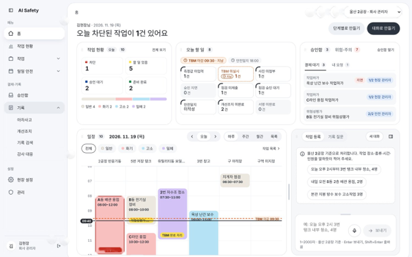
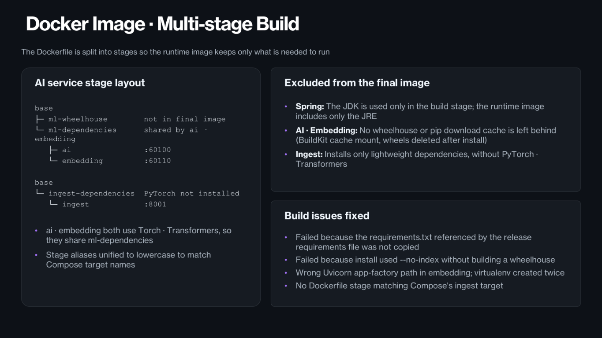
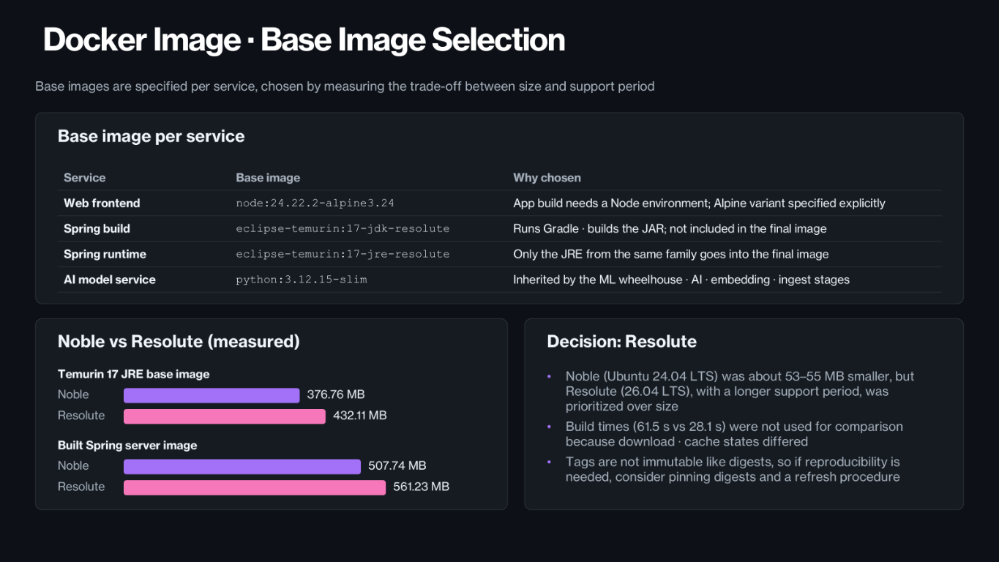
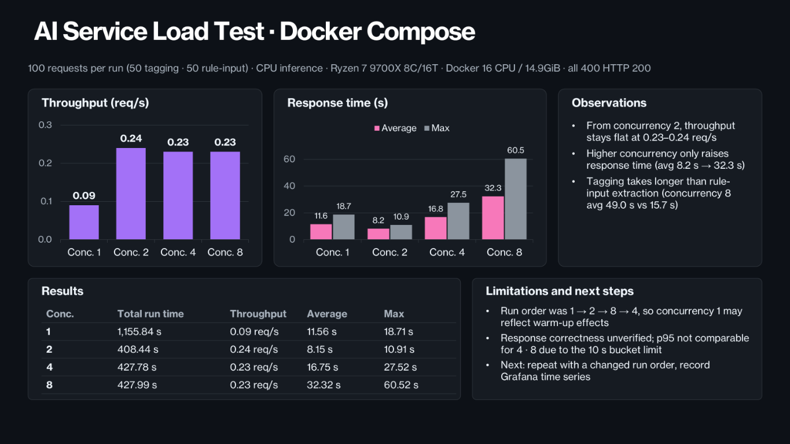
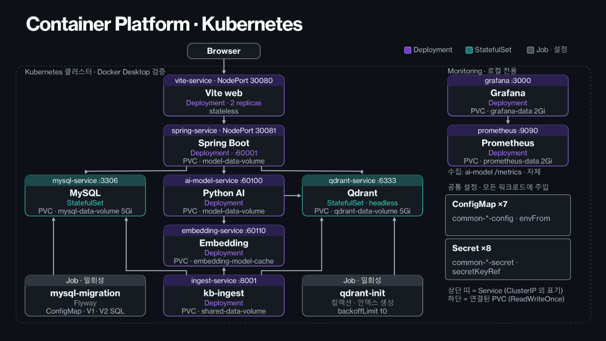

# Main Project

> [!NOTE]
> A version of the README in Korean can be found at [main-project-demo](./docs/localization/README.kr.md).

Top-level overview of the repositories that make up the **field safety
management service** — a platform that helps site operators and managers record,
review, and act on workplace safety events, augmented by AI for near-miss
detection, document search, image recognition, and voice input.

The service consists of a React web app, a Spring Boot API, Python AI services,
and an infrastructure repository that ties them together. Each repository is
developed and deployed independently, while local integration and Kubernetes
deployment are managed in the infrastructure repository.

## Key Features

- **Safety operations** — user and permission management, safety/work records,
  approval workflows, notifications, and audit reports (Spring Boot API).
- **AI assistance** — an AI agent, near-miss tagging, and safety-rule extraction
  backed by a local LLM (Qwen family).
- **Vision and speech** — on-site image analysis (YOLOX-Nano) and speech
  transcription (Whisper) for hands-free field reporting.
- **Knowledge search (RAG)** — document ingestion and embedding (BGE-M3) with
  vector search over Qdrant.
- **Integrated operations** — one-command local run via Docker Compose, a
  Kubernetes/Kustomize deployment, and Prometheus + Grafana monitoring.

## Screenshots

> [!NOTE]
> The web UI is currently available in Korean only. Screenshots use demo data.

### Dashboard



The home screen summarizes the day at a glance: work status, today's to-dos
(including TBM, the pre-work safety briefing), pending approvals, a timeline of
scheduled work, and the AI assistant panel.

### AI assistant


Operators can register work in plain conversation. The assistant asks for missing
details (such as work hours) and creates draft work items, along with the related
risk assessment, high-place work permit, and TBM, to review before requesting
approval. Voice input is also available.

### Audit report


Monthly audit-response reports combine key metrics (planned/completed work,
approvals, risk-assessment completion rate) with an AI-written summary opinion
that reviewers can edit before exporting.

## Architecture Overview


The system is split into three layers, and the web app never talks to the AI
components or databases directly. All traffic goes through the API server.

### Layers

| Layer | Components | Responsibility |
|---|---|---|
| Application | `vite-web` (React SPA served by Nginx), `spring-server` (Spring Boot 4 REST API) | UI, authentication/permissions, business logic, and orchestration of AI calls |
| AI components | Qwen-series local LLM, Whisper, YOLOX-Nano, Knowledge Ingest API, BGE-M3 Embedding API | Agent answers, speech-to-text, site photo analysis, document ingestion and embedding |
| Data | MySQL 8.4, Qdrant | Relational data (users, records, approvals, audit) and vector search index |

An optional SMTP mail server is the only external dependency, used for
notifications.

### Request flows

1. **Standard API request** — An operator or admin uses the React app, which sends
   REST requests to `/api`. The web tier proxies them to the Spring Boot server,
   which reads and writes MySQL (JDBC, with schema managed by Flyway).
2. **AI features** — For agent, speech-to-text, and vision requests, the Spring
   Boot server calls the matching AI component. The local LLM answers questions
   with RAG by searching vectors in Qdrant.
3. **Knowledge ingestion** — The Spring Boot server sends knowledge input to the
   Knowledge Ingest API, which asks the BGE-M3 Embedding API to embed the
   documents, then stores vectors in Qdrant and metadata in MySQL.
4. **Notifications** — The Spring Boot server can optionally send alerts through
   the SMTP mail server.

### Deployment and observability

`infra-manage` ties the services together. Docker Compose runs the whole stack
locally, Kubernetes/Kustomize handles cluster deployment, and Prometheus scrapes
metrics and health checks from the API server and AI components for Grafana
dashboards. See [Deployment and Operations](#deployment-and-operations) for the
container topology diagrams.

## Repositories

| Repository | Role | Tech stack |
|---|---|---|
| [vite-web](./vite-web) | React web app for field safety management | React 19, React Router 7, Vite 8, Node.js 24 |
| [spring-server](./spring-server) | Field safety management API server | Java 17, Spring Boot 4, MySQL, Flyway, JWT |
| [ai-model](./ai-model) | AI, embedding, and knowledge ingest services | Python 3.12, FastAPI, BGE-M3, Qdrant |
| [infra-manage](./infra-manage) | Integrated run and deployment infrastructure | Docker Compose, Kubernetes, MySQL, Grafana |

## Services and Ports

| Component | Local dev port | Docker port | Notes |
|---|---|---|---|
| Web (Vite) | 50001 | 50001 | Proxies `/api` requests to the server |
| API server (Spring Boot) | 8080 | 60001 | Swagger UI at `/swagger-ui/index.html` |
| AI API | 60100 | 60100 | Health check at `/health` |
| Embedding API | 60110 | 60110 | Readiness check at `/ready` |
| Knowledge ingest API | 8001 | 8001 | Readiness check at `/ready` |
| Qdrant init | — | one-off | Initializes collections and indexes |

## Quick Start

The simplest way to run everything together is with the infrastructure
repository's Docker Compose setup. All four repositories must live under the same
parent directory.

```text
main-project-demo/
├── vite-web/
├── spring-server/
├── ai-model/
└── infra-manage/
```

Create `infra-manage/docker/.env` with the required variables and secrets,
then run Compose from the infrastructure repository root.

```powershell
docker compose --env-file .\docker\.env -f .\docker\docker-compose.yml up -d --build
```

For the required environment variables, inter-container connection addresses, and
initialization tasks, see the
[Docker execution guide in infra-manage](./infra-manage/docker/README.md).

## Deployment and Operations

The `infra-manage` repository deploys the application and data layers via Docker
Compose and Kubernetes/Kustomize, and collects metrics and health checks from the
API server and AI components through Prometheus and Grafana.

### Deployment and monitoring overview


`infra-manage` provides three tools for the same set of deploy targets (the web
app, API server, and AI components in the application layer, plus MySQL and
Qdrant in the data layer):

- **Docker Compose** — local and single-host integrated runs.
- **Kubernetes / Kustomize** — production-style cluster deployment.
- **Prometheus → Grafana** — collects metrics and health checks from the API
  server and AI components and visualizes them.

### Docker Compose topology


- **Networking** — All services share the default Compose bridge network. Only the
  web (`:50001`), Grafana (`:3000`), and Prometheus (`:9090`) are published to the
  host; the API server, AI API, embedding, ingest, MySQL, and Qdrant are reachable
  only inside the network.
- **Persistence** — Named volumes keep state for MySQL (`database-data`), Qdrant
  (`qdrant-data`), the embedding model cache, the AI model cache, Grafana, and
  Prometheus.
- **One-shot jobs** — `kb-migrator` runs Flyway schema migrations and
  `qdrant-init` creates Qdrant collections and indexes. Both use `restart: no`.
- **Startup order** (`depends_on`) — MySQL and Qdrant healthy → Spring Boot;
  `qdrant-init` done and Embedding healthy → Python AI; MySQL healthy →
  `kb-migrator`; `qdrant-init` done → `kb-ingest`.
- **Configuration** — Connection details are injected into containers from the
  `.env` file through `${...}` variables.
- **Monitoring** — Grafana and Prometheus are for local use only.

### Docker image strategy and trade-offs



- **Multi-stage builds** — Build-only tooling stays out of the runtime images:
  Spring ships only a JRE, the embedding image keeps no wheelhouse or pip cache,
  and ingest installs lightweight dependencies without PyTorch or Transformers.
  `ai` and `embedding` share one `ml-dependencies` stage.
- **Trade-off** — Smaller runtime images and a smaller attack surface come at the
  cost of more stages and cache rules to maintain. Stage names must match the
  Compose `target` names (aliases are lowercase).



Base images are pinned per service (`node:24.22.2-alpine3.24`,
`eclipse-temurin:17-jdk/jre-resolute`, `python:3.12.15-slim`).

- **Decision: Resolute over Noble** — Noble (Ubuntu 24.04 LTS) is about 53–55 MB
  smaller (JRE base 376.76 MB vs 432.11 MB; built Spring image 507.74 MB vs
  561.23 MB), but Resolute (26.04 LTS) has a longer support period, which was
  prioritized over size.
- **Caveat** — Build times (61.5 s vs 28.1 s) were not compared because download
  and cache states differed. Tags are not immutable, so pin digests and define a
  refresh procedure if reproducibility is required.

### AI service load test



Each run sent 100 requests (50 tagging, 50 rule-input extraction) with CPU
inference on a Ryzen 7 9700X and Docker 16 CPU / 14.9 GiB. All 400 responses
were HTTP 200.

- **Trade-off** — Concurrency 2 gave the best result (0.24 req/s, 8.15 s average).
  Concurrency 4 and 8 stayed at 0.23 req/s while average latency rose to 16.75 s
  and 32.32 s, so higher concurrency only adds latency on this CPU-bound workload.
- **Limitations** — The run order was 1 → 2 → 8 → 4, so concurrency 1 may
  reflect warm-up effects. Response correctness is unverified, and p95 is not
  comparable for 4 and 8 because of the 10 s bucket limit. Next: repeat with a
  changed run order and record Grafana time series.

### Kubernetes topology



- **Environment** — Verified on a Docker Desktop Kubernetes cluster.
- **Workloads** — Stateless services run as Deployments: Vite web (2 replicas),
  Spring Boot, Python AI, Embedding, `kb-ingest`, Grafana, and Prometheus. MySQL
  and Qdrant (headless) run as StatefulSets.
- **Exposure** — The web and API are exposed via NodePort (`30080` and `30081`).
  Other services use cluster-internal Services such as `mysql-service:3306`,
  `ai-model-service:60100`, `qdrant-service:6333`, `embedding-service:60110`, and
  `ingest-service:8001`.
- **Storage** — PersistentVolumeClaims (ReadWriteOnce) back MySQL and Qdrant
  (5Gi each), Grafana and Prometheus (2Gi each), and the model/embedding caches.
- **Jobs** — `mysql-migration` (Flyway, with V1/V2 SQL from a ConfigMap) and
  `qdrant-init` (`backoffLimit: 10`) run once.
- **Shared configuration** — Seven `common-*-config` ConfigMaps (via `envFrom`)
  and eight `common-*-secret` Secrets (via `secretKeyRef`) are injected into the
  workloads.
- **Monitoring** — Prometheus scrapes the `ai-model` `/metrics` endpoint and
  itself, and Grafana reads from Prometheus.

## Per-Repository Development

To develop and test each repository individually, refer to its README.

- Web: [vite-web/README.md](./vite-web/README.md) — `npm ci`, then `npm run dev`
- Server: [spring-server/README.md](./spring-server/README.md) — `\.\gradlew.bat bootRun`
- AI: [ai-model/README.md](./ai-model/README.md) — create `.venv`, then run `uvicorn`
- Infra: [infra-manage/README.md](./infra-manage/README.md) — Compose and Kubernetes

## Repository-wide configuration

- [`.gitignore`](./.gitignore) is managed only at the workspace root. Project-specific
  exclusions are scoped to their project directory.
- Docker Compose build contexts resolve `vite-web`, `spring-server`, and `ai-model`
  as sibling directories under `main-project-demo`.

## Collaborators

| Name | Role | GitHub |
|---|---|---|
| GEONWOO CHOI | Maintainer | [@geonwoo8873](https://github.com/geonwoo8873) |
| Mingi Choi | Contributor | [@GreyColor10](https://github.com/GreyColor10) |
| tmdwls1226 | Contributor | [@tmdwls1226](https://github.com/tmdwls1226) |
| Youngmin Kim | Contributor | [@kymin9118](https://github.com/kymin9118) |

## Notes

- Manage passwords, JWT keys, internal API tokens, and mail/external service
  credentials via local environment variables or `.env` files, and never commit
  them to the repositories.
- Example values such as those in `.env.example` are not runnable credentials.
- Do not place real production secrets in Kubernetes manifest Secrets; decide on a
  cluster secret management approach before applying them.
