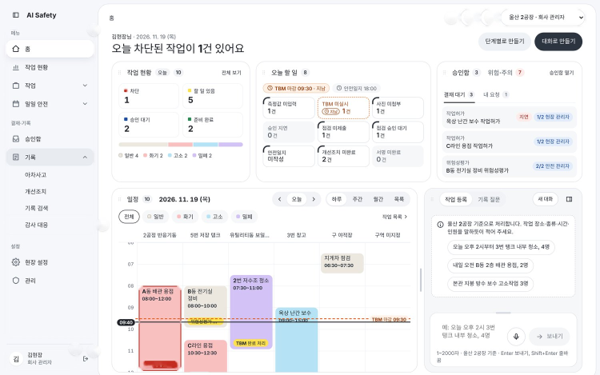
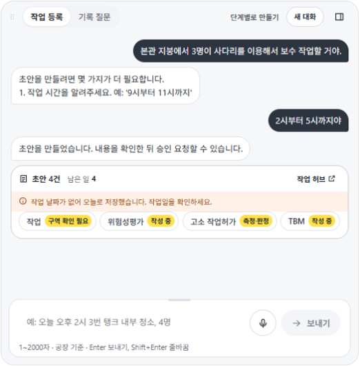
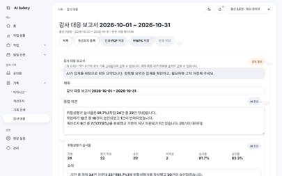
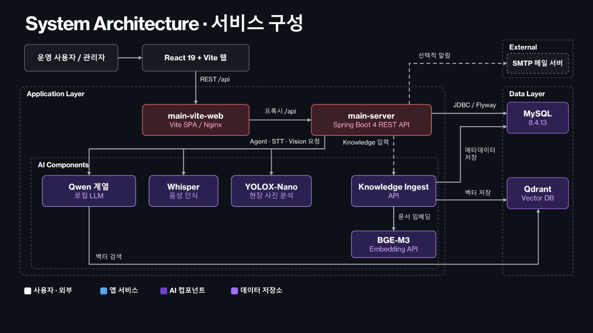
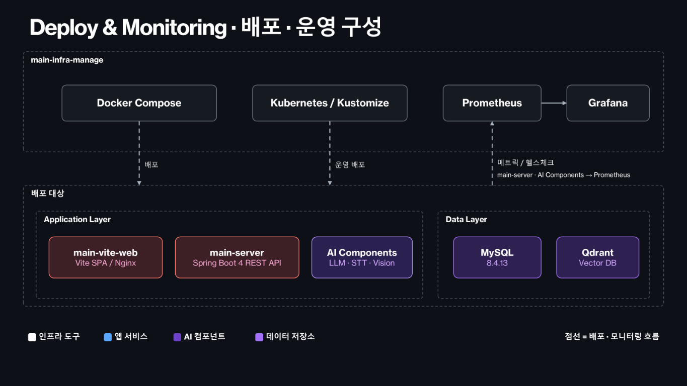
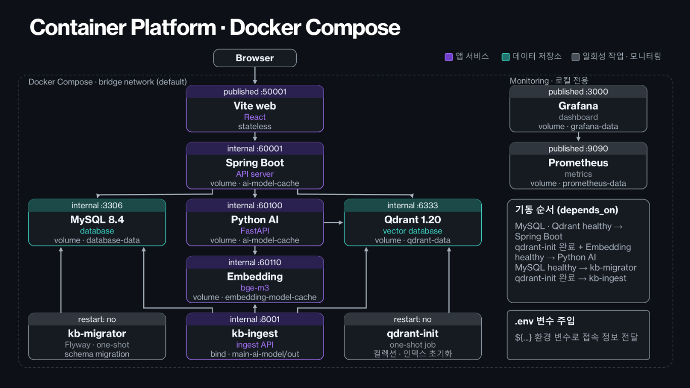
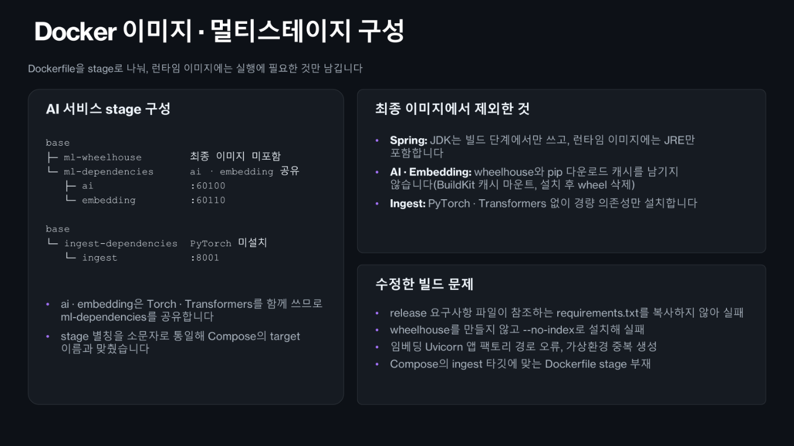
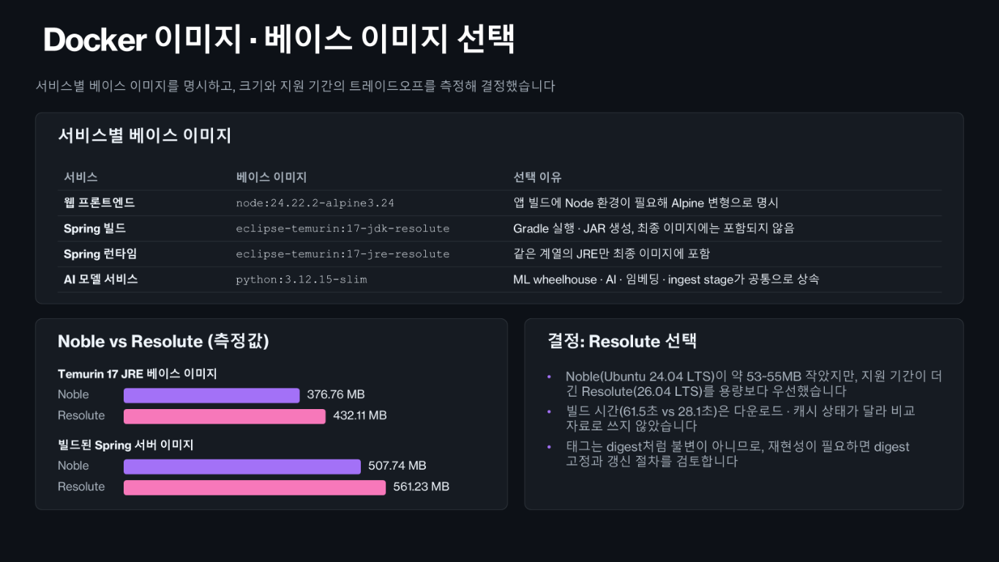
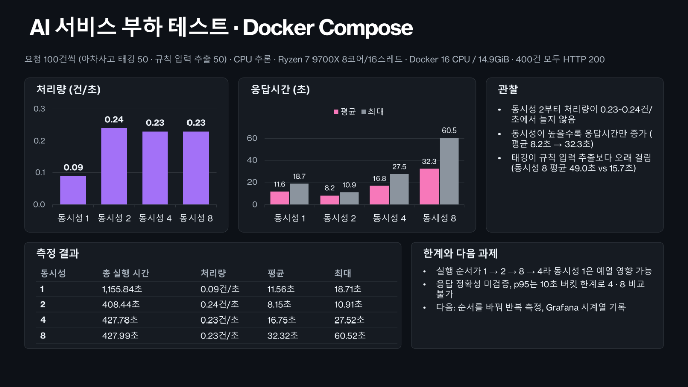
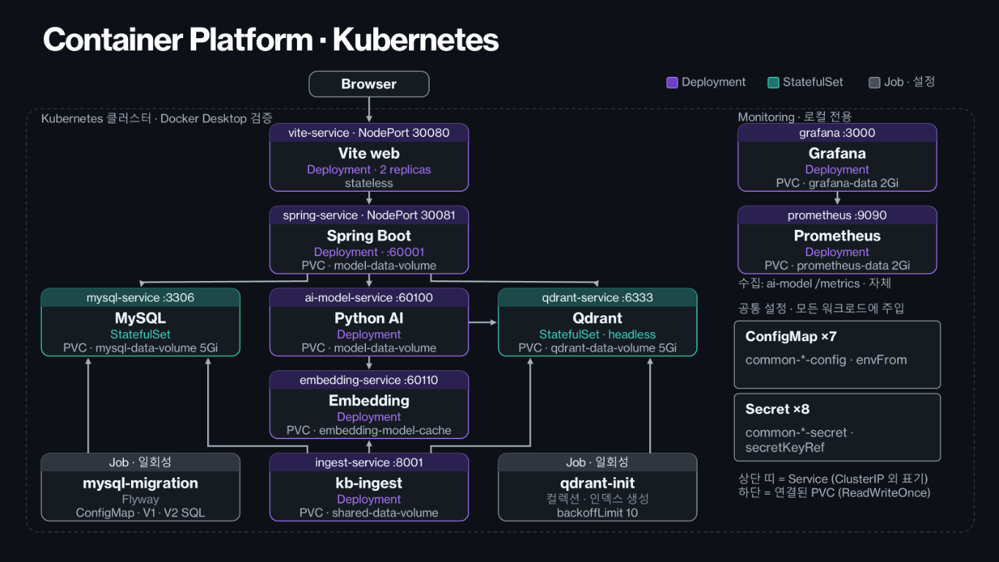

# Main Project

> [!NOTE]
> 영문으로 작성된 README는 [main-project-demo](../../README.md)에서 확인하실 수 있습니다.

현장 안전관리 서비스를 구성하는 전체 저장소를 소개하는 상위 프로젝트 문서입니다.
이 **현장 안전관리 서비스**는 현장 작업자·관리자가 안전 사고를 기록·검토·조치할 수
있도록 돕는 플랫폼으로, 아차사고 탐지·문서 검색·이미지 인식·음성 입력에 AI를
활용합니다.

이 서비스는 React 웹, Spring Boot API, Python AI 서비스, 그리고 이들을 연결하는
인프라 저장소로 구성됩니다. 각 저장소는 독립적으로 개발·배포되며, 로컬 통합과
Kubernetes 배포는 인프라 저장소에서 함께 관리합니다.

## 핵심 기능

- **안전 운영** — 사용자·권한 관리, 안전·작업 기록, 승인 워크플로, 알림, 감사
  리포트 (Spring Boot API).
- **AI 지원** — 로컬 LLM(Qwen 계열) 기반의 AI 에이전트, 아차사고 태깅, 안전 규칙
  추출.
- **비전·음성** — 현장 사진 분석(YOLOX-Nano)과 음성 인식(Whisper)으로 손이 자유로운
  현장 보고 지원.
- **지식 검색 (RAG)** — 문서 적재·임베딩(BGE-M3)과 Qdrant 기반 벡터 검색.
- **통합 운영** — Docker Compose 원커맨드 로컬 실행, Kubernetes/Kustomize 배포,
  Prometheus·Grafana 모니터링.

## 화면 미리보기

> [!NOTE]
> 스크린샷은 데모 데이터를 사용합니다.

### 대시보드



홈 화면에서 작업 현황, 오늘 할 일(작업 전 안전 점검인 TBM 포함), 승인 대기, 작업
일정 타임라인, AI 어시스턴트 패널을 한눈에 확인할 수 있습니다.

### AI 어시스턴트



작업자는 대화만으로 작업을 등록할 수 있습니다. 어시스턴트가 작업 시간처럼 빠진
정보를 되묻고, 작업 초안과 관련 위험성평가·고소 작업허가·TBM 초안을 만들어
승인 요청 전에 검토할 수 있게 합니다. 음성 입력도 지원합니다.

### 감사 대응 보고서



월간 감사 대응 보고서는 작업 계획·완료, 승인, 위험성평가 작성률 등 주요 지표와
AI가 작성한 종합 의견을 함께 보여주며, 검토자가 의견을 수정한 뒤 내보낼 수
있습니다.

## 아키텍처 개요



시스템은 세 개의 계층으로 나뉘며, 웹 앱은 AI 컴포넌트나 데이터베이스에 직접
접근하지 않습니다. 모든 요청은 API 서버를 거칩니다.

### 계층 구성

| 계층 | 구성 요소 | 역할 |
|---|---|---|
| 애플리케이션 | `vite-web` (Nginx로 서빙되는 React SPA), `spring-server` (Spring Boot 4 REST API) | UI, 인증·권한, 비즈니스 로직, AI 호출 조율 |
| AI 컴포넌트 | Qwen 계열 로컬 LLM, Whisper, YOLOX-Nano, 지식 적재 API, BGE-M3 임베딩 API | 에이전트 응답, 음성 인식, 현장 사진 분석, 문서 적재·임베딩 |
| 데이터 | MySQL 8.4, Qdrant | 관계형 데이터(사용자·기록·결재·감사)와 벡터 검색 인덱스 |

선택적으로 사용하는 SMTP 메일 서버가 유일한 외부 의존성이며, 알림 발송에 쓰입니다.

### 요청 흐름

1. **일반 API 요청** — 운영자·관리자가 React 앱을 사용하면 `/api`로 REST 요청이
   전송되고, 웹 계층이 이를 Spring Boot 서버로 프록시합니다. 서버는 MySQL을
   읽고 씁니다(JDBC, 스키마는 Flyway로 관리).
2. **AI 기능** — 에이전트·음성 인식·비전 요청은 Spring Boot 서버가 해당 AI
   컴포넌트를 호출합니다. 로컬 LLM은 Qdrant의 벡터 검색(RAG)으로 질문에
   답합니다.
3. **지식 적재** — Spring Boot 서버가 지식 입력을 지식 적재 API로 보내면, 이 API가
   BGE-M3 임베딩 API로 문서를 임베딩하고 벡터는 Qdrant에, 메타데이터는 MySQL에
   저장합니다.
4. **알림** — Spring Boot 서버는 필요 시 SMTP 메일 서버를 통해 알림을 보낼 수
   있습니다.

### 배포와 관측

`infra-manage`가 서비스들을 하나로 연결합니다. Docker Compose는 전체 스택을
로컬에서 실행하고, Kubernetes/Kustomize는 클러스터 배포를 담당하며, Prometheus가
API 서버와 AI 컴포넌트의 메트릭·헬스체크를 수집해 Grafana 대시보드로 보여줍니다.
컨테이너 구성도는 [배포·운영](#배포운영)을 참고하세요.

## 저장소 구성

| 저장소 | 역할 | 기술 스택 |
|---|---|---|
| [vite-web](../../vite-web) | 현장 안전관리 React 웹 애플리케이션 | React 19, React Router 7, Vite 8, Node.js 24 |
| [spring-server](../../spring-server) | 현장 안전관리 API 서버 | Java 17, Spring Boot 4, MySQL, Flyway, JWT |
| [ai-model](../../ai-model) | AI·임베딩·지식 적재 서비스 | Python 3.12, FastAPI, BGE-M3, Qdrant |
| [infra-manage](../../infra-manage) | 통합 실행 및 배포 인프라 | Docker Compose, Kubernetes, MySQL, Grafana |

## 서비스와 포트

| 구성 | 로컬 개발 포트 | Docker 포트 | 비고 |
|---|---|---|---|
| 웹 (Vite) | 50001 | 50001 | `/api` 요청을 서버로 프록시 |
| API 서버 (Spring Boot) | 8080 | 60001 | Swagger UI `/swagger-ui/index.html` |
| AI API | 60100 | 60100 | 상태 확인 `/health` |
| 임베딩 API | 60110 | 60110 | 상태 확인 `/ready` |
| 지식 적재 API | 8001 | 8001 | 상태 확인 `/ready` |
| Qdrant 초기화 | — | 일회성 | 컬렉션·인덱스 초기화 |

## 빠른 시작

가장 간단한 통합 실행은 인프라 저장소의 Docker Compose를 사용하는 방식입니다.
네 저장소가 같은 상위 디렉터리에 있어야 합니다.

```text
main-project-demo/
├── vite-web/
├── spring-server/
├── ai-model/
└── infra-manage/
```

`infra-manage/docker/.env`를 만들고 필요한 변수와 비밀 값을 입력한 뒤,
인프라 프로젝트 루트에서 Compose를 실행합니다.

```powershell
docker compose --env-file .\docker\.env -f .\docker\docker-compose.yml up -d --build
```

필수 환경 변수, 컨테이너 간 연결 주소, 초기화 작업은
[infra-manage의 Docker 실행 가이드](infra-manage-docker.README.kr.md)를
참고하세요.

## 배포·운영

`infra-manage` 저장소는 애플리케이션·데이터 계층을 Docker Compose와
Kubernetes/Kustomize로 배포하며, API 서버와 AI 컴포넌트의 메트릭·헬스체크를
Prometheus와 Grafana로 수집합니다.

### 배포·모니터링 개요



`infra-manage`는 동일한 배포 대상(애플리케이션 계층의 웹·API 서버·AI 컴포넌트,
데이터 계층의 MySQL·Qdrant)에 대해 세 가지 도구를 제공합니다.

- **Docker Compose** — 로컬 및 단일 호스트 통합 실행.
- **Kubernetes / Kustomize** — 운영 환경을 가정한 클러스터 배포.
- **Prometheus → Grafana** — API 서버와 AI 컴포넌트의 메트릭·헬스체크를 수집해
  시각화.

### Docker Compose 구성



- **네트워크** — 모든 서비스는 Compose 기본 브리지 네트워크를 공유합니다. 호스트에
  게시되는 포트는 웹(`:50001`), Grafana(`:3000`), Prometheus(`:9090`)뿐이며, API
  서버·AI API·임베딩·적재·MySQL·Qdrant는 네트워크 내부에서만 접근할 수 있습니다.
- **영속성** — MySQL(`database-data`), Qdrant(`qdrant-data`), 임베딩 모델 캐시, AI
  모델 캐시, Grafana, Prometheus는 이름 있는 볼륨으로 상태를 유지합니다.
- **일회성 작업** — `kb-migrator`는 Flyway 스키마 마이그레이션을, `qdrant-init`은
  Qdrant 컬렉션·인덱스 초기화를 수행하며 둘 다 `restart: no`입니다.
- **기동 순서** (`depends_on`) — MySQL·Qdrant 정상 → Spring Boot,
  `qdrant-init` 완료 + 임베딩 정상 → Python AI, MySQL 정상 → `kb-migrator`,
  `qdrant-init` 완료 → `kb-ingest`.
- **설정** — 접속 정보는 `.env` 파일의 `${...}` 변수로 컨테이너에 주입됩니다.
- **모니터링** — Grafana와 Prometheus는 로컬 전용입니다.

### Docker 이미지 전략과 트레이드오프



- **멀티 스테이지 빌드** — 빌드 전용 도구를 런타임 이미지에서 제외합니다. Spring은
  JRE만 포함하고, 임베딩 이미지에는 wheelhouse와 pip 다운로드 캐시를 남기지 않으며,
  ingest는 PyTorch·Transformers 없이 경량 의존성만 설치합니다. `ai`와
  `embedding`은 `ml-dependencies` 스테이지를 공유합니다.
- **트레이드오프** — 런타임 이미지와 공격 표면이 작아지는 대신 관리할 스테이지와
  캐시 규칙이 늘어납니다. 스테이지 이름은 Compose `target`과 일치해야 합니다(별칭은
  소문자로 통일).



서비스별 베이스 이미지는 명시해 둡니다(`node:24.22.2-alpine3.24`,
`eclipse-temurin:17-jdk/jre-resolute`, `python:3.12.15-slim`).

- **결정: Noble 대신 Resolute** — Noble(Ubuntu 24.04 LTS)이 약 53~55MB 더 작지만
  (JRE 베이스 376.76MB 대 432.11MB, 빌드된 Spring 이미지 507.74MB 대 561.23MB),
  지원 기간이 더 긴 Resolute(26.04 LTS)를 용량보다 우선했습니다.
- **주의점** — 빌드 시간(61.5초 대 28.1초)은 다운로드·캐시 상태가 달라 비교
  자료로 쓰지 않았습니다. 태그는 digest처럼 불변이 아니므로, 재현성이 필요하면
  digest 고정과 갱신 절차를 검토합니다.

### AI 서비스 부하 테스트



매 실행마다 요청 100건(아차사고 태깅 50건, 규칙 입력 추출 50건)을 Ryzen 7 9700X
CPU 추론, Docker 16 CPU / 14.9GiB 환경에서 보냈고, 400건 모두 HTTP 200이었습니다.

- **트레이드오프** — 동시성 2가 가장 좋았습니다(0.24건/초, 평균 8.15초). 동시성
  4·8은 처리량이 0.23건/초로 그대로인 반면 평균 응답은 16.75초, 32.32초로
  늘어, CPU 중심 워크로드에서는 동시성을 높여도 지연만 커집니다.
- **한계** — 실행 순서가 1 → 2 → 8 → 4라 동시성 1은 예열 영향이 있을 수 있습니다.
  응답 정확성은 미검증이며, p95는 10초 버킷 한계로 4·8을 비교할 수 없습니다.
  다음 단계로 순서를 바꿔 반복 측정하고 Grafana 시계열을 기록합니다.

### Kubernetes 구성



- **환경** — Docker Desktop의 Kubernetes 클러스터에서 검증했습니다.
- **워크로드** — 상태가 없는 서비스는 Deployment로 실행합니다: Vite 웹(레플리카
  2개), Spring Boot, Python AI, 임베딩, `kb-ingest`, Grafana, Prometheus. MySQL과
  Qdrant(headless)는 StatefulSet으로 실행합니다.
- **노출** — 웹과 API는 NodePort(`30080`, `30081`)로 노출됩니다. 나머지는
  `mysql-service:3306`, `ai-model-service:60100`, `qdrant-service:6333`,
  `embedding-service:60110`, `ingest-service:8001`처럼 클러스터 내부 Service를
  사용합니다.
- **스토리지** — PersistentVolumeClaim(ReadWriteOnce)이 MySQL·Qdrant(각 5Gi),
  Grafana·Prometheus(각 2Gi), 모델·임베딩 캐시를 뒷받침합니다.
- **Job** — `mysql-migration`(Flyway, ConfigMap의 V1/V2 SQL 사용)과
  `qdrant-init`(`backoffLimit: 10`)이 일회성으로 실행됩니다.
- **공통 설정** — `common-*-config` ConfigMap 7개(`envFrom`)와 `common-*-secret`
  Secret 8개(`secretKeyRef`)를 워크로드에 주입합니다.
- **모니터링** — Prometheus는 `ai-model`의 `/metrics`와 자기 자신을 수집하고,
  Grafana는 Prometheus를 데이터 소스로 사용합니다.

## 저장소별 개발 안내

각 저장소를 개별적으로 개발·테스트하려면 해당 저장소의 README를 참고하세요.

- 웹: [vite-web README](vite-web.README.kr.md) — `npm ci` 후 `npm run dev`
- 서버: [spring-server README](spring-server.README.kr.md) — `\.\gradlew.bat bootRun`
- AI: [ai-model README](ai-model.README.kr.md) — `.venv` 생성 후 `uvicorn`
- 인프라: [infra-manage README](infra-manage.README.kr.md) — Compose·Kubernetes

## 협업 인원

| 이름 | 역할 | GitHub |
|---|---|---|
| GEONWOO CHOI | 메인테이너 | [@geonwoo8873](https://github.com/geonwoo8873) |
| Mingi Choi | 기여자 | [@GreyColor10](https://github.com/GreyColor10) |
| tmdwls1226 | 기여자 | [@tmdwls1226](https://github.com/tmdwls1226) |
| 김영민 | 기여자 | [@kymin9118](https://github.com/kymin9118) |

## 주의 사항

- 비밀번호, JWT 키, 내부 API 토큰, 메일·외부 서비스 자격 증명은 로컬 환경 변수나
  `.env`로 관리하고 저장소에 커밋하지 마세요.
- `.env.example` 등 예시 값은 그대로 실행 가능한 자격 증명이 아닙니다.
- Kubernetes 매니페스트의 Secret에는 실제 운영 비밀 값을 두지 말고, 클러스터의
  Secret 관리 방식을 정한 뒤 적용하세요.
